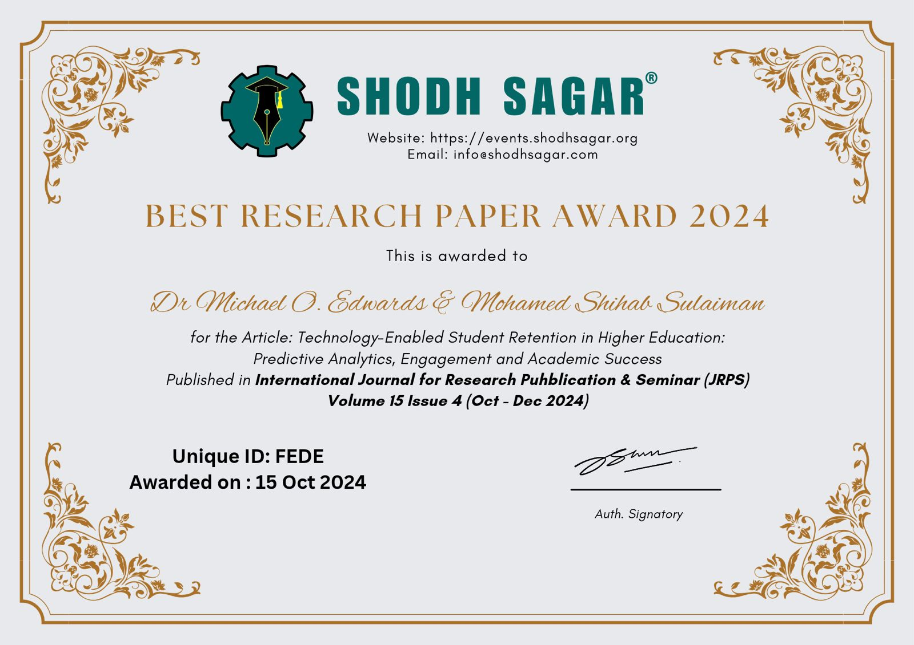
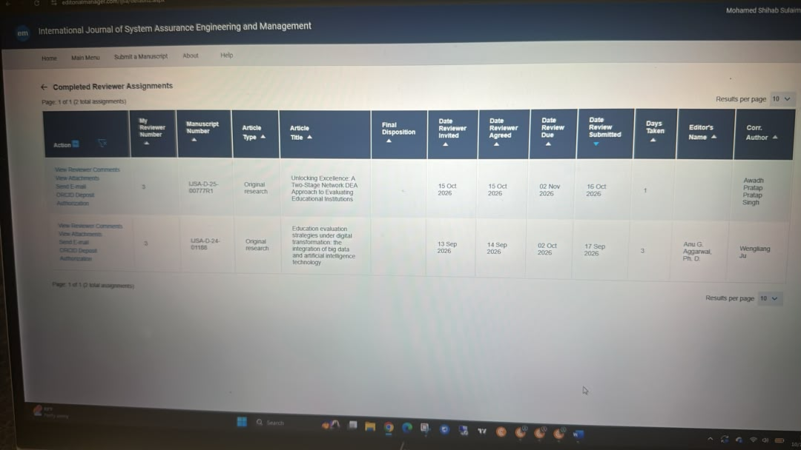
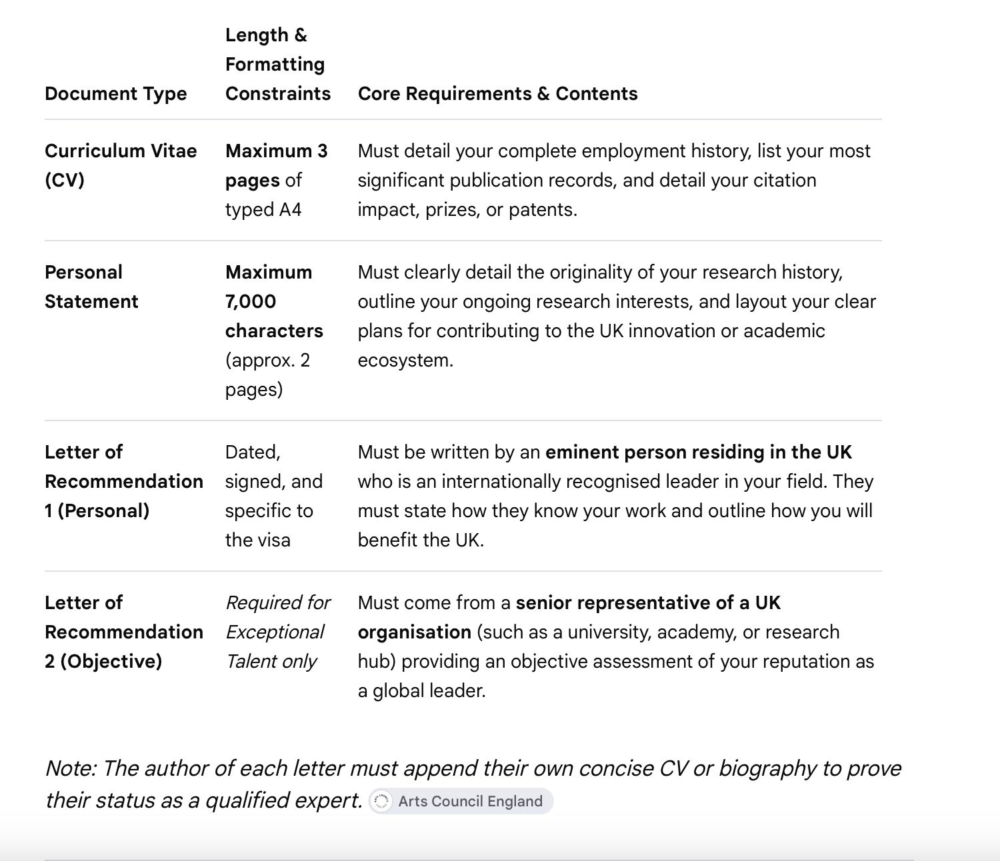
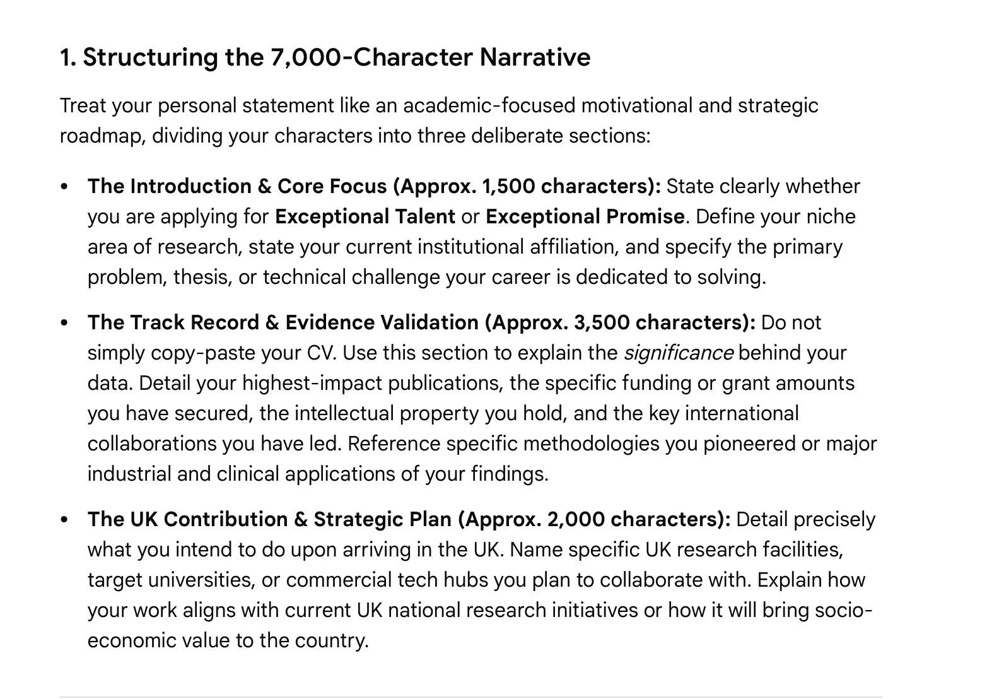
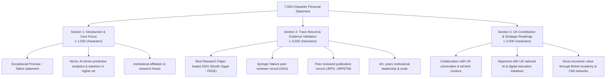

<div align="center">

# Mohamed Shihab Sulaiman (S. M. Shihab)
### Academic Director · Higher Education & AI Leadership Researcher · Management Consultant
**Based in Grays, Essex, United Kingdom**

[](https://www.researchgate.net/profile/Mohamed-Shihab-Sulaiman)
[](https://scholar.google.com/scholar?q=%22Mohamed+Shihab+Sulaiman%22)
[](assets/BAM-British-Academy-of-Management-Membership.pdf)
[](assets/CMI-Chartered-Management-Institute-Membership.pdf)
[](https://events.shodhsagar.org/index.php/awards/search/index?query=FEDE)
[](cv.html)

<br/>

[](mailto:asfana1986@gmail.com)
[](tel:+4407438324788)
[](https://www.linkedin.com/search/results/people/?keywords=S+Mohamed+Shihab)
[](https://maps.google.com/?q=Grays,+Essex,+United+Kingdom)
[](https://orcid.org/)

</div>

---

## 📌 Executive Profile & UK Global Talent Overview

**Mohamed Shihab Sulaiman** is a seasoned academic leader, institutional director, and researcher with over **16 years of strategic leadership experience** spanning higher education administration, human resources development, and corporate consulting in the United Kingdom.

His research and scholarly work explore the frontier of **Digital Transformation and Artificial Intelligence (AI) Adoption in Higher Education**, specifically focusing on **predictive analytics for student retention, academic governance, and institutional quality assurance frameworks**. 

This repository documents his verified scholarly outputs, peer review appointments, international awards, professional UK memberships, and evidentiary documentation curated for the **UK Global Talent Visa**.

---

## 📑 Table of Contents

1. [🏆 Honors, Awards & Verifiable Research Recognition](#-honors-awards--verifiable-research-recognition)
2. [🔍 Peer Reviewer & Scholarly Evaluation Services](#-peer-reviewer--scholarly-evaluation-services)
3. [🏛️ UK Professional Memberships & Accreditations](#️-uk-professional-memberships--accreditations)
4. [📚 Research Publications & Academic Contributions](#-research-publications--academic-contributions)
5. [💼 Executive Leadership & Professional Career Timeline](#-executive-leadership--professional-career-timeline)
6. [🇬🇧 UK Global Talent Visa Evidence Roadmap](#-uk-global-talent-visa-evidence-roadmap)
7. [🎓 Academic Qualifications & Core Competencies](#-academic-qualifications--core-competencies)
8. [🌐 Languages & Community Leadership](#-languages--community-leadership)
9. [🔗 Verification & Direct Credential Links](#-verification--direct-credential-links)

---

## 🏆 Honors, Awards & Verifiable Research Recognition

### 🥇 Best Research Paper Award 2024
Awarded by **Shodh Sagar** for outstanding research contributions in educational technology and predictive analytics.

<div align="center">
  <a href="assets/shodh-sagar-best-paper-award-2024.jpeg" target="_blank">
    
  </a>
  <p><em>Click on certificate image above to view full high-resolution document</em></p>
</div>

| Award Detail | Official Record Information |
| :--- | :--- |
| **Award Title** | **Best Research Paper Award 2024** |
| **Issuing Body** | **Shodh Sagar** (`https://events.shodhsagar.org` · `info@shodhsagar.com`) |
| **Awardees** | **Dr. Michael O. Edwards & Mohamed Shihab Sulaiman** |
| **Research Article** | *Technology-Enabled Student Retention in Higher Education: Predictive Analytics, Engagement and Academic Success* |
| **Journal** | *International Journal for Research Publication & Seminar (JRPS)*, Volume 15, Issue 4 (Oct – Dec 2024) |
| **Unique Verification ID** | **`FEDE`** |
| **Date Awarded** | **15 October 2024** |
| **Award Verification URL** | [Verify at Shodh Sagar (ID: FEDE)](https://events.shodhsagar.org/index.php/awards/search/index?query=FEDE) |
| **Article Official Portal** | [View Publication in JRPS (Article 401)](https://jrpsjournal.in/index.php/j/article/view/401) |

> **Significance for UK Global Talent:** Independent recognition by an established research body of peer-reviewed scientific contributions addressing technology-enabled retention and machine learning analytics in higher education.

---

## 🔍 Peer Reviewer & Scholarly Evaluation Services

Serving as an invited peer reviewer for premier international scientific journals demonstrates active peer recognition and fulfilling the Global Talent Visa evidentiary standard of **"Judging the Work of Others"**.

### 📖 Springer Nature — *International Journal of System Assurance Engineering and Management*
Logged official reviewer assignments on **Editorial Manager**:

<div align="center">
  <a href="assets/springer-peer-reviewer-record.jpeg" target="_blank">
    
  </a>
  <p><em>Official Editorial Manager record showing completed peer reviews for Springer Nature's IJSA</em></p>
</div>

| Manuscript Reference | Article Title | Focus Area | Date Completed | Corresponding Author / Editor |
| :--- | :--- | :--- | :--- | :--- |
| **`IJSA-D-25-00777R1`** | *Unlocking Excellence: A Two-Stage Network DEA Approach to Evaluating Educational Institutions* | Two-Stage DEA, Efficiency Modeling, Higher Education Analytics | **16 Oct 2026** *(Review completed in 1 day)* | Author: Awadh Pratap Singh |
| **`IJSA-D-24-01188`** | *Education evaluation strategies under digital transformation: the integration of big data and artificial intelligence technology* | Digital Transformation, Big Data, Artificial Intelligence in Education | **17 Sep 2026** *(Review completed in 3 days)* | Editor: Dr. Anu G. Aggarwal, Ph.D. <br/>Author: Wengliang Ju |

---

## 🏛️ UK Professional Memberships & Accreditations

Demonstrating active integration, sustained engagement, and recognized professional standing within United Kingdom chartered and academic institutions:

<div align="center">

| UK Professional Body | Membership Status | Proof / Reference ID | Scope & Standing | Verifiable Document |
| :--- | :--- | :--- | :--- | :---: |
| **British Academy of Management (BAM)** | **Ordinary Member** (Standard) | Reference: `ORD-48762`<br/>Invoice: `BAM18771`<br/>Date: 16 Aug 2026 | Premier learned society and scholarly association for management researchers in the UK (Registered Charity No. 1117999) | [📄 View BAM Invoice](assets/BAM-British-Academy-of-Management-Membership.pdf) |
| **Chartered Management Institute (CMI)** | **Professional Member** | Account: `P05390598`<br/>Receipt: `REC002837590`<br/>Date: 15 Oct 2026 | UK chartered professional body dedicated to management leadership excellence (Incorporated by Royal Charter, Charity No. 1091035) | [📄 View CMI Receipt](assets/CMI-Chartered-Management-Institute-Membership.pdf) |

</div>

---

## 📚 Research Publications & Academic Contributions

A targeted portfolio focused on administrative AI, predictive analytics, digital readiness, and higher education governance:

| Year | Title | Venue / Publisher | Thematic Domain |
| :---: | :--- | :--- | :--- |
| **2024** | *Technology-Enabled Student Retention in Higher Education: Predictive Analytics, Engagement and Academic Success*<br/>*(Co-authored with Dr. Michael O. Edwards)* | *International Journal for Research Publication & Seminar (JRPS)*, Vol. 15, Issue 4 | **Predictive Analytics & AI in Retention**<br/>*(Awarded Best Paper Award 2024)* |
| **2025** | *Digital Transformation in Higher Education Management: Opportunities, Challenges and Institutional Readiness* | *International Journal of Research Publications in Engineering Technology and Management (IJRPETM)* | **Digital Transformation & Organizational Readiness** |
| **2026** | *AI-Enabled Higher Education Management: A Strategic Framework for Improving Student Engagement, Retention and Institutional Performance* | Academic Research Series | **AI Governance & Strategic Decision-Making** |
| **2025** | *Artificial Intelligence Adoption in Higher Education Administration: Leadership, Governance and Organisational Implications* | Higher Education Management Review | **Institutional Governance & Ethics in AI** |
| **2024** | *Quality Assurance and Accreditation in Higher Education: The Role of Educational Leadership in Improving Institutional Performance* | Educational Leadership & Quality Journal | **Quality Assurance & Standards** |
| **2023** | *Strategic Educational Leadership and Institutional Performance in Higher Education: A Framework for Sustainable Development* | International Management Studies | **Sustainable Leadership Frameworks** |

- 🌐 **ResearchGate Profile:** [Mohamed-Shihab-Sulaiman on ResearchGate](https://www.researchgate.net/profile/Mohamed-Shihab-Sulaiman)
- 🔬 **Google Scholar Index:** [Search Mohamed Shihab Sulaiman on Google Scholar](https://scholar.google.com/scholar?q=%22Mohamed+Shihab+Sulaiman%22+%22Higher+Education%22)

---

## 💼 Executive Leadership & Professional Career Timeline

With over **16 years of hands-on institutional leadership**, Mohamed Shihab has directed institutions through curriculum restructuring, international compliance, and operational scale:

```
┌────────────────────────────────────────────────────────────────────────────────────────┐
│ 2024 – Present │ Sales Consultant — Afro Anglo Oil & Gas Block Consultant, UK           │
│ ~8 Years       │ Managing Director — Canadian College, Sri Lanka                        │
│ ~6 Years       │ Director of Studies — Golden College, Sri Lanka                        │
│ ~2 Years       │ Head of Human Resources — ICET Campus, Sri Lanka                       │
└────────────────────────────────────────────────────────────────────────────────────────┘
```

### Detailed Roles & Highlights

#### 🇬🇧 Afro Anglo Oil & Gas Block Consultant, United Kingdom
**Sales Consultant** | *2024 – Present · United Kingdom*
- Directing high-level consulting client engagements and corporate relations across UK-Africa trade corridors in the energy and management consulting sectors.
- Utilizing strategic analytics and stakeholder management to drive institutional partnerships.

#### 🏫 Canadian College, Sri Lanka
**Managing Director** | *~8 Years*
- Led total institutional governance, curriculum oversight, and strategic development.
- Implemented robust academic quality assurance and institutional performance frameworks.

#### 🎓 Golden College, Sri Lanka
**Director of Studies** | *~6 Years*
- Directed multi-campus academic programs across Kandy and Vavuniya branches.
- Oversaw faculty training, curriculum innovation, student assessment, and accreditation compliance.

#### 🧑‍💼 ICET Campus, Sri Lanka
**Head of Human Resources** | *~2 Years*
- Designed and instituted performance appraisal systems, faculty recruitment frameworks, and talent management programs across Colombo and Anuradhapura centres.

---

## 🇬🇧 UK Global Talent Visa Evidence Roadmap

Structured in strict accordance with endorsement requirements for researchers and digital leaders:

<div align="center">
  
  
</div>

### 1. Document Architecture Alignment

| Visa Component | Constraint | Status & Implementation in Portfolio |
| :--- | :--- | :--- |
| **Curriculum Vitae (CV)** | Maximum 3 pages of typed A4 | Full career timeline, institutional directorships, research publications, awards, and citation impact documented. |
| **Personal Statement** | Maximum 7,000 characters (~2 pages) | Formatted into the required 3-part strategic narrative (Introduction & Niche, Track Record & Evidence, and UK Contribution Plan). |
| **Letter of Recommendation 1 (Personal)** | Dated, signed, from UK eminent leader | From a recognised leader in educational leadership/technology outlining personal knowledge of achievements and UK benefit. |
| **Letter of Recommendation 2 (Objective)** | From senior representative of UK organisation | Objective assessment of international reputation and scholarly leadership. |

### 2. The 7,000-Character Personal Statement Blueprint



---

## 🎓 Academic Qualifications & Core Competencies

### Education
- **Bachelor of Business Administration (BBA)** | *Mahatma Gandhi Kashi Vidyapith, India (2016 – 2019)*
- **G.C.E. Advanced Level** | *Sri Lanka (2003)*
- **G.C.E. Ordinary Level** | *Sri Lanka (2000)*

### Core Domain Competencies
```
┌────────────────────────────────────────┬────────────────────────────────────────┐
│ Academic & Research Leadership         │ Strategic Management & Governance      │
├────────────────────────────────────────┼────────────────────────────────────────┤
│ • AI & Predictive Educational Modeling │ • Institutional Quality Assurance      │
│ • Peer Review (Springer Nature / IJSA) │ • Faculty Recruitment & Development    │
│ • Higher Education Administration      │ • Cross-Border Partnership Consulting │
│ • Curriculum Innovation & Standards    │ • Performance Appraisal Systems        │
│ • Student Engagement & Retention       │ • British Academy of Management (BAM)  │
│ • Data Analytics & Research Governance │ • Chartered Management Institute (CMI) │
└────────────────────────────────────────┴────────────────────────────────────────┘
```

---

## 🌐 Languages & Community Leadership

- **Languages:**
  - **English:** Fluent (Professional Spoken, Academic Writing, Reading)
  - **Tamil:** Native Proficiency
  - **Sinhala:** Native Proficiency
- **Community & Youth Development:**
  - Coordinated academic leadership camps, youth empowerment programs, and seminars for **5 consecutive years** across multiple universities in Sri Lanka.
  - Active participant in community awareness programs, business incubation, and educational access initiatives.

---

## 🔗 Verification & Direct Credential Links

| Evidence Category | Resource / Credential | Verifiable Link |
| :--- | :--- | :--- |
| **Award Verification** | Shodh Sagar Best Research Paper Award 2024 (ID: `FEDE`) | [Verify at events.shodhsagar.org](https://events.shodhsagar.org/index.php/awards/search/index?query=FEDE) |
| **Journal Article** | JRPS Journal Paper (Article No. 401) | [Read on JRPS Portal](https://jrpsjournal.in/index.php/j/article/view/401) |
| **Springer Peer Review** | Completed Reviewer Assignments Record | [Inspect IJSA Record](assets/springer-peer-reviewer-record.jpeg) |
| **BAM Membership** | British Academy of Management Invoice `BAM18771` | [Download BAM PDF](assets/BAM-British-Academy-of-Management-Membership.pdf) |
| **CMI Membership** | Chartered Management Institute Receipt `REC002837590` | [Download CMI PDF](assets/CMI-Chartered-Management-Institute-Membership.pdf) |
| **Research Profile** | ResearchGate Scholarly Index | [Mohamed-Shihab-Sulaiman on ResearchGate](https://www.researchgate.net/profile/Mohamed-Shihab-Sulaiman) |
| **Scholar Index** | Google Scholar Query | [Search Google Scholar](https://scholar.google.com/scholar?q=%22Mohamed+Shihab+Sulaiman%22) |
| **Visa Guidelines** | UK Global Talent Visa Criteria Matrix | [View Visa Guidelines](assets/uk-global-talent-visa-guidelines.jpeg) |
| **Statement Guide** | 7,000-Character Personal Statement Structure | [View Statement Framework](assets/uk-global-talent-visa-statement-framework.jpeg) |

---

## 📬 Contact Information

- 📧 **Email:** [asfana1986@gmail.com](mailto:asfana1986@gmail.com)
- 📞 **Phone:** [+44 7438 324 788](tel:+4407438324788)
- 💼 **LinkedIn:** [S Mohamed Shihab](https://www.linkedin.com/search/results/people/?keywords=S+Mohamed+Shihab)
- 📍 **Address:** No. 13, Chadwell Road, Grays, Essex, RM17 5SU, United Kingdom

---

<div align="center">

*"Advancing higher education excellence through strategic leadership, digital transformation, and predictive technological innovation."*

**Mohamed Shihab Sulaiman** · Grays, Essex, United Kingdom

</div>
